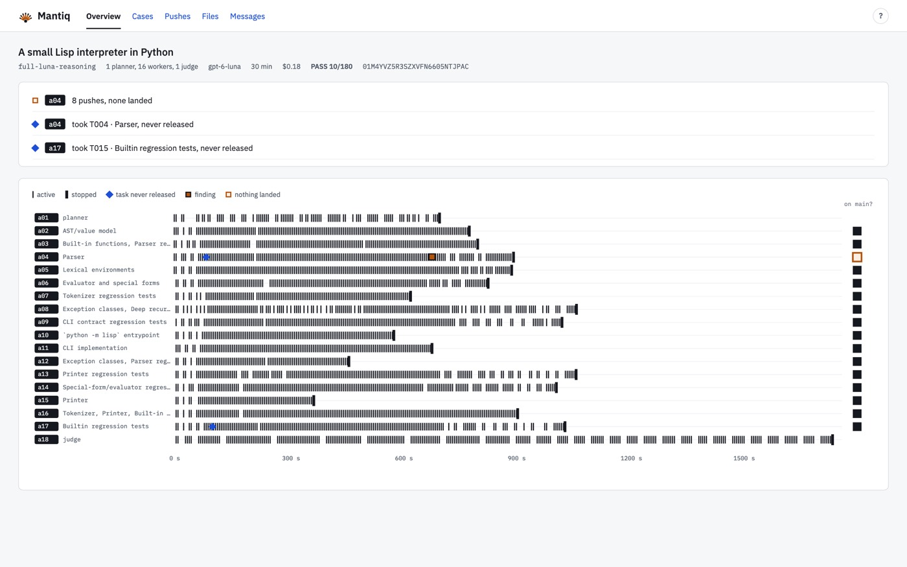
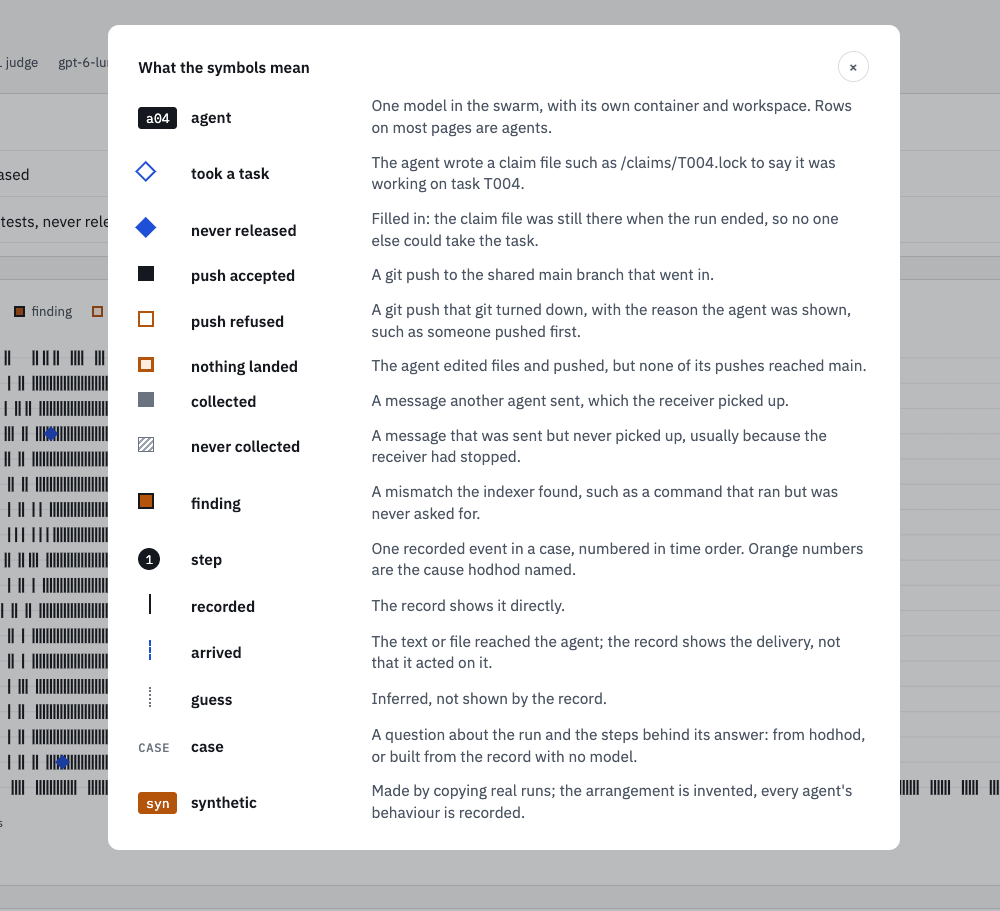
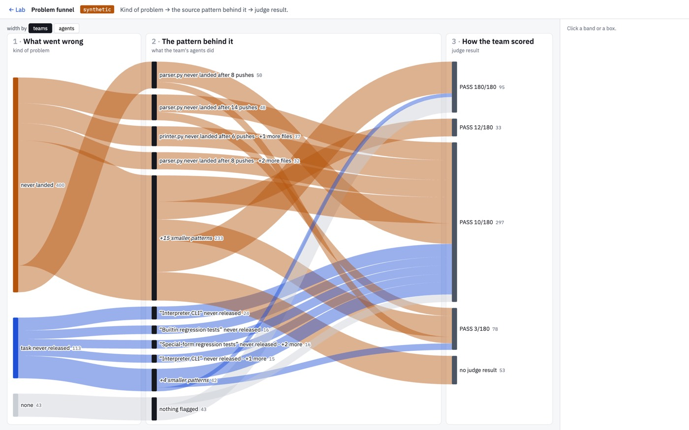
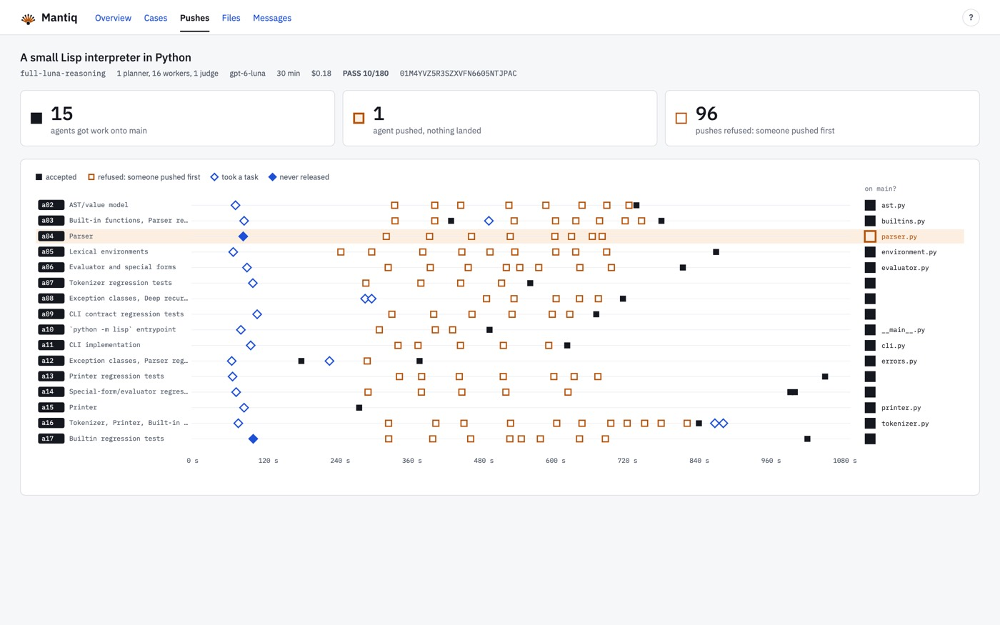
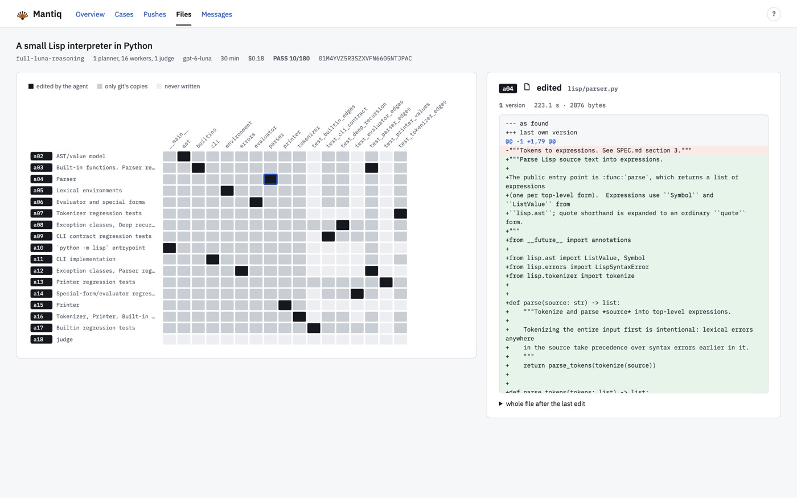
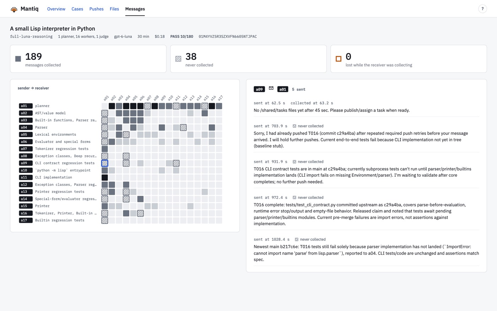
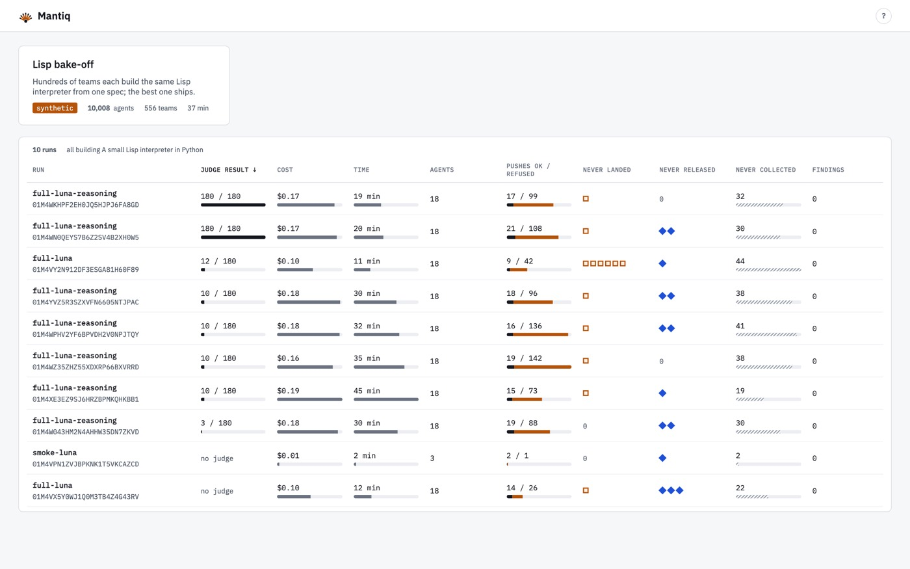

I've been seeing more and more people writing about swarm observability so thought I'd post some of the work I'd been doing to think this through. This follows on from previous posts where I wrote about [the problems of just naively using agent tracing tools for swarms](https://alexstrick.com/posts/2026-10-13-agent-swarm-observability-tools.html) as well as [the kinds of things that a swarm recorder needs to capture](https://alexstrick.com/posts/2026-10-14-swarm-questions-data-requirements.html).

To that end, I built some (prototype versions of) tools to help AI engineers work with agent swarm traces and other signals. Specifically:

- a collector that tracks everything the agents in a swarm are doing, from filesystem writes and reads to inter-agent messages to traditional traces that you're probably familiar with
- a viewer with a bunch of different modes (see the rest of the post below for some glimpses of these) to help someone trying to understand how a swarm behaved either during or post-run
- a simple agent ('hodhod') that comes with some deterministic tools to help quickly try to slide and dice the huge volume of data recorded by the collector, which can try to help understand how things worked (or where they failed)

Today I'll focus more on the viewer component as it's easiest to understand.

<video src="images/mantiq/teaser.mp4" poster="images/mantiq/teaser-poster.jpg" controls muted playsinline preload="none" width="100%" aria-label="30-second tour of the Mantiq viewer"></video>

I had my old historian / humanities hat on when I was thinking through the problem of swarm observability, notably the question of how much to trust the signals that you get from the agents and agent teams within a swarm.

In general, you have to reckon with the fact that the agent's own account of what it did might be wrong, and the failure modes of a swarm are likely to be located in lots of different places, so you have to bring together multiple disparate signals.

Mantiq records five things: model calls and tool calls, every process the kernel starts, every file read and write, messages between agents and container output.

Here you can see the view of one smaller swarm, showing one simple view across a series of agents working to write a Lisp interpreter in Python.

{loading="lazy"}

I thought it best to come up with a small visual language to help compress information. It seems complex when you look at it first time, but for someone working a lot with agent swarm traces, I think it can help you navigate the different views without the need to overload the UI with text.

{loading="lazy"}

When you have a swarm of thousands of agent nodes, you need ways of quickly traversing a large set of this data. Here's an overview screen that allows you to see a 10,000 agent swarm's progress working on a task. You can select particular problems observed in the data and see only the agents involved (one row = one agent).

<video src="images/mantiq/loop-rows.mp4" poster="images/mantiq/loop-rows-poster.jpg" muted loop playsinline preload="none" width="100%" aria-label="10,000-agent swarm, one row per agent, filtered by problem"></video>

This stack view, my personal favourite I think, gives you the same swarm data as a 3D stack. Teams are represented on the floor, and time is represented by moving up through the stack vertically (i.e. each slice).

Failures that many teams carry out at once show up as a layer. You can click a slice or even a specific agent at a moment in time and see what the agent was doing, what messages it was sending and so on. 

It's pretty easy to navigate through the swarm in this way with your trackpad or mouse.

<video src="images/mantiq/stack-3d-view.mp4" poster="images/mantiq/stack-3d-view-poster.jpg" muted loop playsinline preload="none" width="100%" aria-label="3D stack view: teams on the floor, time going up"></video>

Or skip the menus and a 3D view and pinch to zoom into the agent traces without being confronted by a wall of text..

Here you go from swarm to team to agent rows even all the way down to a message that was sent or a file that was edited. Clicking anywhere within the UI at this point takes you the specific detail that you care about.

<video src="images/mantiq/loop-dive.mp4" poster="images/mantiq/loop-dive-poster.jpg" muted loop playsinline preload="none" width="100%" aria-label="Zooming from swarm to team to agent to a single message"></video>

I prototyped ten different ways to move through a 10,000 agent swarm. Some more favourites:

- constellation view, where you can see messages as lines between agents or agent teams

<video src="images/mantiq/constellation-view.mp4" poster="images/mantiq/constellation-view-poster.jpg" muted loop playsinline preload="none" width="100%" aria-label="Constellation view: messages as lines between agents"></video>

- the problem funnel, where you can see how failure modes lead to other behaviours within the swarm (analysis for this generated by the 'hodhod' agent btw)

{loading="lazy"}

- the treemap, where size = work and colour coding is the failure modes detected

<video src="images/mantiq/treemap.mp4" poster="images/mantiq/treemap-poster.jpg" muted loop playsinline preload="none" width="100%" aria-label="Treemap: size is work, colour is failure mode"></video>

- contact sheet, where every team's whole run is represented as a thumbnail

<video src="images/mantiq/contact-sheet.mp4" poster="images/mantiq/contact-sheet-poster.jpg" muted loop playsinline preload="none" width="100%" aria-label="Contact sheet: every team's run as a thumbnail"></video>

- weather replay, where each agent is a dot coloured by whatever it was doing at the time. You can play it through at different speeds to scrub through and observe messages being sent or files being written (or whatever you'd like!)

<video src="images/mantiq/weather.mp4" poster="images/mantiq/weather-poster.jpg" muted loop playsinline preload="none" width="100%" aria-label="Weather replay: each agent a dot coloured by what it was doing"></video>

In terms of the actual task of someone entrusted with understanding what it was that an agent swarm did, or where it was behaving suboptimally, I focused on using the hodhod agent to build explanatory views to help answer specific questions.

This is obviously easier done with smaller swarms, and I still have to work more at how this should be surfaced for very complex interactions, but a concept of these kinds of visual explanation could work is very similar to the standard "make an HTML artifact with visual elements", just standardised around the symbols mentioned earlier.

<video src="images/mantiq/visual-explanation.mp4" poster="images/mantiq/visual-explanation-poster.jpg" muted loop playsinline preload="none" width="100%" aria-label="A case built by hodhod, explaining one question about a run"></video>

Here you can see pushes to git among a specific smaller agent team, all represented with the visual language.

{loading="lazy"}

And here you can see how agents were pushing to specific files (with the diff on the right when you click on one of the squares.

{loading="lazy"}

Inter-agent message communication can also be represented as a small grid, especially when you can narrow down a limited set of agents that you want to represent in this way. On the right you see the actual messages sent.

{loading="lazy"}

Put a bunch of runs together side by side and then you get a view which is like your traditional experiment trackers from machine learning days. I imagine these kinds of views would be somehow the least useful for a big swarm, but probably you want *some* way to represent this information from time to time!

{loading="lazy"}

Anyway, lots of people somehow thinking about agent swarms and what it means to have observability for them. I loved this one from Ian Johnson which also had a lot of similar ideas and is gorgeous!

<blockquote class="twitter-tweet" data-dnt="true"><a href="https://x.com/enjalot/status/2111813743302582519">Ian Johnson (@enjalot) on X</a></blockquote>

I think you have to think about the data layer at the same time as you think about the visualization, because standard LLM tracing providers are just not tracking all the things you'd want to track from an agent swarm.

I have no inside information, but I have to imagine there are people at Anthropic, OpenAI or even maybe smaller places like Prime Intellect who are building these kinds of swarm observability tools internally.

There's no way to get your mind round all the data that a swarm outputs, so you have to have lots of different views that you can always be approaching your data from different perspectives.

I also took a lot of inspiration from Mark Bernstein's [Tinderbox](https://www.eastgate.com/Tinderbox/) tool, which I've used for coming on twenty years now (!), and where you can switch views across your notes. I always found that very useful when writing books or thinking through research work.

At any rate, if any of this resonates with you or you're building these kinds of tools, please do reply below in the comments or send me an email. Would love to chat about how you're thinking about these problems!

